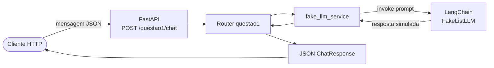
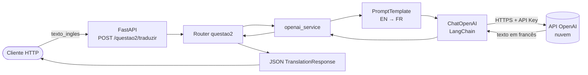
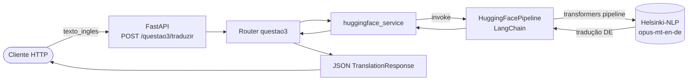

# Diagramas de arquitetura — Parte 2

## Diagrama 1 — Questão 1: Chatbot com FakeListLLM

**Notas**

- Não há chamada externa: respostas vêm de uma lista fixa no `FakeListLLM`.
- Útil para testar contrato JSON, rotas e tratamento de erros sem consumir API paga.
- O comportamento de “rodízio” das respostas é inerente ao `FakeListLLM`, não a um modelo treinado.

---

## Diagrama 2 — Questão 2: Tradução EN→FR com OpenAI

**Notas**

- A chave `OPENAI_API_KEY` é lida de variável de ambiente no serviço (não versionada).
- Latência total ≈ rede + tempo do modelo remoto; `temperature=0` favorece traduções estáveis.
- Falhas de quota ou rede mapeiam para HTTP 502/503 nos routers.

---

## Diagrama 3 — Questão 3: Tradução EN→DE com HuggingFacePipeline

**Notas**

- O modelo é carregado no **lifespan** do FastAPI (uma vez por worker), amortizando cold start.
- Inferência local: sem custo por token, mas exige RAM e competição por CPU com outras requisições.
- Comparado à Parte 1 (MarianMT direto), o fluxo lógico é o mesmo; LangChain adiciona a facade `HuggingFacePipeline` para unificar `invoke()` com outros LLMs.
