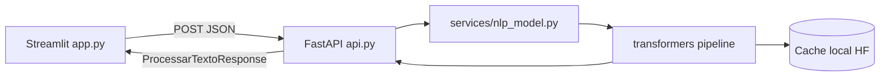

# Justificativa do Modelo de NLP — TP4 ConectaFood

Documento técnico da entrega acadêmica: escolha do modelo, integração com FastAPI e evidências de desempenho medidas localmente.

---

## 1. Contexto e problema de negócio

O projeto **ConectaFood** integra dados de ONGs e projetos sociais alinhados aos ODS 2 (Fome Zero) e ODS 12 (Consumo Responsável). As descrições das organizações estão no arquivo `projetos_sociais.csv` e são **textos livres em português**, difíceis de comparar manualmente quando há dezenas de registros.

**Objetivo da análise de sentimento:** apoiar a leitura das descrições das ONGs no dashboard e na API, classificando o tom de cada texto em **1 a 5 estrelas**. Isso permite destacar narrativas mais engajadoras, comparar ONGs de forma consistente e sinalizar textos neutros ou ambíguos (por exemplo, descrições muito factuais com confiança baixa) para revisão editorial futura.

## 2. Requisitos da solução (TP4)

- Execução **100% local**, sem APIs de nuvem ou modelos hospedados remotamente na inferência.
- Biblioteca **Hugging Face `transformers`** para carga e inferência do modelo.
- Exposição via **FastAPI** (`POST /processar_texto`).
- Contratos **Pydantic** e erros HTTP (**422**, **400**, **503**).
- Interface **Streamlit** consumindo a rota para teste manual.

## 3. Modelo escolhido

| Item | Valor |
|------|--------|
| **Identificador Hugging Face** | [`nlptown/bert-base-multilingual-uncased-sentiment`](https://huggingface.co/nlptown/bert-base-multilingual-uncased-sentiment) |
| **Família** | BERT-base multilíngue (`bert-base-multilingual-uncased`) com *fine-tuning* para sentimento |
| **Saída** | Cinco classes: **1 a 5 estrelas** |
| **Idioma** | **Multilíngue** (inclui português; adequado ao domínio ConectaFood) |
| **Tamanho em disco (pesos)** | ~670 MB após download no cache local |

### 3.1 Desempenho — precisão, idioma e comparação com alternativa

**Por que este modelo e não um classificador inglês leve (ex.: DistilBERT SST-2)?**

| Critério | `nlptown/bert-base-multilingual-uncased-sentiment` | `distilbert-base-uncased-finetuned-sst-2-english` (alternativa descartada) |
|----------|---------------------------------------------------|----------------------------------------------------------------------------|
| Idioma | Treinado para **vários idiomas**, incluindo **português** | **Inglês**; descrições em PT sofrem degradação sem tradução prévia |
| Granularidade | **5 estrelas** (útil para ranquear ONGs) | Binário **positivo/negativo** |
| Aderência ao domínio | Escala interpretável para stakeholders (1 = muito negativo … 5 = muito positivo) | Menos nuance; rótulos em inglês na saída |
| Custo local | Maior que DistilBERT (~670 MB vs ~260 MB), ainda viável em notebook | Mais leve, porém **inadequado** ao requisito de negócio em português |

O modelo NLP Town partilha a base **`bert-base-multilingual-uncased`**, amplamente usada em NLP multilíngue. O *fine-tuning* para sentimento produz cinco rótulos (`1 star` … `5 stars`); na API eles são mapeados para rótulos em português (ex.: `4 estrelas (positivo)`). Isso atende diretamente a textos como os do ConectaFood, que descrevem impacto social, atendimento e missão — predominantemente em tom informativo a positivo.

**Evidência qualitativa no nosso CSV (inferência local, 16/11/2026):** sobre cinco descrições reais com tamanhos entre **148 e 494 caracteres**, o modelo atribuiu **4 ou 5 estrelas**, coerente com o conteúdo institucional das ONGs (missão social, apoio a públicos vulneráveis). A confiança variou de **~0,47 a 0,57** em textos longos e descritivos — comportamento esperado quando o texto é neutro-informativo em vez de “review” emocional.

**Limitações de desempenho:**

- Textos são truncados a **512 caracteres** na camada de serviço (`services/nlp_model.py`), alinhado ao limite prático do encoder.
- O modelo foi treinado em contextos próximos a **avaliações de produtos**; descrições de ONGs podem parecer “neutras” com confiança moderada.
- Ironia, sarcasmo e negadores complexos em português podem ser mal classificados.

### 3.2 Custo computacional local — medições reais

As métricas abaixo foram obtidas com o script reprodutível `04_Deployment/test_performance.py`, que:

1. Inicia a API via `TestClient` (mesmo `lifespan` que carrega o modelo).
2. Monitora **pico de RAM (RSS)** do processo Python com `psutil`.
3. Envia **5 descrições reais** do CSV, com tamanhos diferentes.
4. Repete **3 inferências por texto** e reporta média, mínimo e máximo de latência por amostra.

**Ambiente de medição**

| Item | Valor medido |
|------|----------------|
| SO | macOS 15.7.7 (ARM64) |
| Python | 3.9.6 |
| CPU | Apple Silicon (`arm`), **8 núcleos lógicos** |
| Dispositivo de inferência | **CPU** (`device=-1` no `pipeline`; sem GPU) |
| Data da execução | 16/11/2026 |

**Memória (processo do benchmark)**

| Métrica | Valor |
|---------|--------|
| RSS antes de carregar o modelo | **315,6 MB** |
| **Pico de RSS** (carga + inferências) | **707,9 MB** |
| Incremento aproximado (modelo + libs) | **~392 MB** |

**Tempo de carga do modelo (pesos já em cache local)**

| Métrica | Valor |
|---------|--------|
| Tempo até `nlp_disponivel=true` (startup `lifespan`) | **1,13 s** |

> **Nota:** na **primeira** execução em uma máquina nova, o Hugging Face Hub baixa ~670 MB para `~/.cache/huggingface/`. O tempo de carga pode passar de minutos nessa etapa; as latências abaixo referem-se a execução com **cache já populado**.

**Latência da rota `POST /processar_texto` (média de 3 chamadas por texto)**

| ONG (amostra) | Caracteres | Latência média (ms) | Mín (ms) | Máx (ms) | Estrelas | Confiança |
|---------------|-----------|---------------------|----------|----------|----------|-----------|
| Associação Antialcoólica do Estado de São Paulo | 148 | 68,06 | 65,18 | 70,70 | 4 | 0,57 |
| Projeto Eu Acredito | 240 | 69,49 | 65,29 | 77,42 | 5 | 0,50 |
| Consulado da mulher | 277 | 87,40 | 83,87 | 90,76 | 4 | 0,49 |
| Desaparecidos do Brasil | 345 | 114,45 | 109,24 | 119,14 | 4 | 0,47 |
| Organização Bem-Animal (OBA!) | 494 | 176,53 | 153,30 | 193,40 | 4 | 0,54 |

| Agregado | Valor |
|----------|--------|
| **Latência média global** (média das médias por texto) | **103,19 ms** |
| Faixa observada (médias por texto) | **68 ms – 177 ms** |

**Uso de CPU:** a inferência é **síncrona em CPU**; picos de utilização concentrados no forward do BERT durante cada `POST`. Em uso interativo (Streamlit), uma requisição por vez mantém a máquina responsiva; processamento em lote do CSV inteiro aumentaria o tempo total de forma linear.

**Custo financeiro:** **R$ 0** em APIs pagas; o custo é **disco** (~670 MB) + **RAM** (~700 MB de pico no processo da API) + **tempo de CPU** por requisição.

O arquivo bruto da medição está em: `04_Deployment/test_performance_resultado.json`.

**Como reproduzir:**

```bash
cd 04_Deployment
../venv/bin/python -m pip install psutil pandas fastapi httpx torch transformers
../venv/bin/python test_performance.py
```

### 3.3 Acessibilidade local — Transformers e arquitetura offline

A biblioteca **`transformers`** reduz a barreira de entrada para NLP local:

1. **`from_pretrained` / `pipeline`:** uma linha de configuração carrega tokenizer + pesos; não é necessário implementar arquitetura BERT manualmente.
2. **Cache Hugging Face:** após o primeiro download, o modelo roda **offline** a partir de `~/.cache/huggingface/hub/`, sem chamadas de inferência à nuvem.
3. **Integração com o projeto:** o serviço `nlp_model.py` encapsula o `pipeline`; a API expõe apenas JSON validado por Pydantic; o Streamlit não importa `torch` — apenas HTTP para `localhost:8000`.



**Dependências de execução:** `torch`, `transformers`, `sentencepiece`, `accelerate` (listadas em `requirements.txt`).

**Comandos:**

```bash
cd 04_Deployment
uvicorn api:app --reload          # API + carga do modelo no lifespan
streamlit run app.py              # UI com aba Análise de Sentimento
```

Se o modelo não carregar, `GET /` retorna `nlp_disponivel: false` e `POST /processar_texto` responde **503** com detalhe do erro — útil para diagnóstico sem depender de logs externos.

## 4. Arquitetura da integração (resumo técnico)

### 4.1 Ciclo de vida do modelo

- No **startup** da API (`lifespan` em `api.py`), `carregar_modelos()` instancia `pipeline("sentiment-analysis", model=MODEL_ID, device=-1)`.
- Estado global `runtime.ready` controla disponibilidade das rotas NLP.

### 4.2 Contrato da API

**Request (`ProcessarTextoRequest`):**

- `texto`: string, 10–4000 caracteres (não pode ser só espaços).
- `tipo_analise`: `sentimento` (único tipo habilitado nesta versão).

**Response (`ProcessarTextoResponse`):**

- `texto_original`, `tipo_analise`, `resultado`, `estrelas` (1–5), `confianca`, `modelo`.

### 4.3 Tratamento de erros

| Código | Situação |
|--------|----------|
| **422** | Validação Pydantic (texto curto, tipo inválido) |
| **400** | Rótulo inesperado do modelo ou regra de negócio |
| **503** | Modelo não carregado (`runtime.ready == false`) |
| **500** | Falha inesperada na inferência |

## 5. Evidências de teste

### Exemplo de requisição

```json
{
  "texto": "a Amigos do Bem possui Centros Educacionais que atendem 1,5 mil crianças...",
  "tipo_analise": "sentimento"
}
```

### Exemplo de resposta real (Projeto Eu Acredito — benchmark)

```json
{
  "texto_original": "...",
  "tipo_analise": "sentimento",
  "resultado": "5 estrelas (muito positivo)",
  "estrelas": 5,
  "confianca": 0.5019301772117615,
  "modelo": "nlptown/bert-base-multilingual-uncased-sentiment"
}
```

**Evidências complementares para o relatório PDF:**

- Captura de tela da documentação interativa: `http://127.0.0.1:8000/docs` → `POST /processar_texto`.
- Captura da aba **Análise de Sentimento** no Streamlit após uma análise bem-sucedida.
- Anexo ou referência ao arquivo `test_performance_resultado.json`.

## 6. Conclusão

O **`nlptown/bert-base-multilingual-uncased-sentiment`** foi adotado por combinar **adequação ao português**, saída em **cinco estrelas** interpretável para o ConectaFood e **viabilidade em CPU** (pico ~708 MB de RAM, latência média ~103 ms por requisição no ambiente medido). A alternativa DistilBERT em inglês seria mais leve, mas **prejudicaria a qualidade** nas descrições em português e reduziria a granularidade da análise.

A stack **FastAPI + `transformers` + cache local** atende aos requisitos do TP4: inferência local, contratos Pydantic, erros HTTP explícitos e consumo via Streamlit sem dependência de APIs externas na hora da predição.

**Evolução opcional (fora do escopo mínimo):** aplicar `POST /processar_texto` em lote sobre todas as descrições do CSV e exibir distribuição de estrelas no dashboard analítico.

## Referências

- [Model card — nlptown/bert-base-multilingual-uncased-sentiment](https://huggingface.co/nlptown/bert-base-multilingual-uncased-sentiment)
- [bert-base-multilingual-uncased](https://huggingface.co/bert-base-multilingual-uncased)
- [Hugging Face — pipelines](https://huggingface.co/docs/transformers/main_classes/pipelines)
- [FastAPI — lifespan](https://fastapi.tiangolo.com/advanced/events/)
- Script de benchmark: `04_Deployment/test_performance.py`