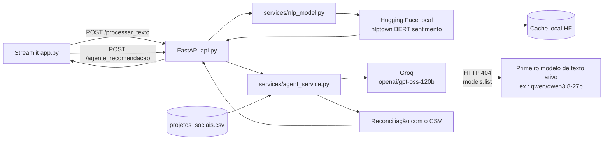

# Justificativa da Arquitetura de IA e Modelos — TP5 ConectaFood

Documento técnico da entrega final: arquitetura híbrida, modelo local de sentimento (TP4) e agente de decisão ESG na Groq (TP5).

---

## 1. Contexto atualizado

O **ConectaFood** parte de um catálogo real de organizações sociais, coletado no Observatório do 3º Setor e gravado em `projetos_sociais.csv`. O problema de negócio não é só classificar um texto. Quem quer investir, voluntariar ou cumprir uma agenda ESG precisa escolher poucas organizações e explicar o impacto dessa escolha nos ODS.

Uma única técnica não cobre as duas perguntas. A primeira é local e barata: qual é o tom desta descrição? A segunda é de comparação e justificativa: dentre as organizações do arquivo, quais atendem este interesse e quais ODS essa parceria fortalece? O sistema final separa essas perguntas em dois modelos, com contratos HTTP diferentes.

| Pergunta | Rota | Onde roda | O que devolve |
|----------|------|-----------|----------------|
| Qual é o tom deste texto? | `POST /processar_texto` | CPU local, Hugging Face | 1 a 5 estrelas e a confiança |
| Com quem este perfil deve se conectar? | `POST /agente_recomendacao` | API Groq | Organizações do CSV, pilar ESG, ODS e próximos passos |

O sentimento não entra no prompt do agente e não é gravado no CSV. As duas leituras do mesmo tipo de texto coexistem: uma tria o tom de uma descrição avulsa; a outra cruza o catálogo com o objetivo de quem decide.

## 2. Por que a arquitetura é híbrida

O classificador local responde em cerca de 100 ms, cabe na RAM medida neste notebook e custa zero por chamada. Ele não recebe um catálogo, não segue um papel de especialista e não emite uma justificativa de Agenda 2030. Forçar esse BERT a “recomendar ONGs” seria usar um encoder de cinco classes para uma tarefa de raciocínio.

O agente faz o contrário. Lê as 48 organizações válidas do CSV, compara o interesse do usuário com várias descrições e devolve um JSON com nomes, pilares (Ambiental, Social, Governança) e ODS numerados. Isso pede janela de contexto larga e adesão a um formato. Um modelo dessa classe não cabe na CPU em que o BERT foi medido (pico de cerca de 708 MB, sem GPU dedicada). A inferência do agente fica na Groq, só quando alguém pede uma recomendação. A triagem de sentimento continua local.

---

## 3. Modelo local de sentimento

Esta seção permanece em operação no TP5. Os números abaixo são os medidos em 16/11/2026 e não foram reestimados.

### 3.1 Problema que este modelo resolve

As descrições das organizações são textos livres em português. O objetivo da análise de sentimento é classificar o tom de cada texto em **1 a 5 estrelas**, para comparar narrativas e sinalizar textos neutros ou ambíguos (confiança baixa) para revisão futura. Não é o mecanismo de escolha do parceiro.

### 3.2 Requisitos herdados

- Execução **100% local**, sem API de nuvem na inferência deste modelo.
- Biblioteca **Hugging Face `transformers`**.
- Exposição via **FastAPI** (`POST /processar_texto`).
- Contratos **Pydantic** e erros HTTP (**422**, **400**, **503**).
- Interface **Streamlit** consumindo a rota para teste manual.

### 3.3 Modelo escolhido

| Item | Valor |
|------|--------|
| **Identificador Hugging Face** | [`nlptown/bert-base-multilingual-uncased-sentiment`](https://huggingface.co/nlptown/bert-base-multilingual-uncased-sentiment) |
| **Família** | BERT-base multilíngue (`bert-base-multilingual-uncased`) com *fine-tuning* para sentimento |
| **Saída** | Cinco classes: **1 a 5 estrelas** |
| **Idioma** | **Multilíngue** (inclui português; adequado ao domínio ConectaFood) |
| **Tamanho em disco (pesos)** | ~670 MB após download no cache local |

### 3.4 Desempenho — precisão, idioma e comparação com alternativa

**Por que este modelo e não um classificador inglês leve (ex.: DistilBERT SST-2)?**

| Critério | `nlptown/bert-base-multilingual-uncased-sentiment` | `distilbert-base-uncased-finetuned-sst-2-english` (alternativa descartada) |
|----------|---------------------------------------------------|----------------------------------------------------------------------------|
| Idioma | Treinado para **vários idiomas**, incluindo **português** | **Inglês**; descrições em PT sofrem degradação sem tradução prévia |
| Granularidade | **5 estrelas** (útil para ranquear ONGs) | Binário **positivo/negativo** |
| Aderência ao domínio | Escala interpretável para stakeholders (1 = muito negativo … 5 = muito positivo) | Menos nuance; rótulos em inglês na saída |
| Custo local | Maior que DistilBERT (~670 MB vs ~260 MB), ainda viável em notebook | Mais leve, porém **inadequado** ao requisito de negócio em português |

O modelo NLP Town partilha a base **`bert-base-multilingual-uncased`**, amplamente usada em NLP multilíngue. O *fine-tuning* para sentimento produz cinco rótulos (`1 star` … `5 stars`); na API eles são mapeados para rótulos em português (ex.: `4 estrelas (positivo)`). Isso atende diretamente a textos como os do ConectaFood, que descrevem impacto social, atendimento e missão — predominantemente em tom informativo a positivo.

**Evidência qualitativa no nosso CSV (inferência local, 16/11/2026):** sobre cinco descrições reais com tamanhos entre **148 e 494 caracteres**, o modelo atribuiu **4 ou 5 estrelas**, coerente com o conteúdo institucional das ONGs (missão social, apoio a públicos vulneráveis). A confiança variou de **~0,47 a 0,57** em textos longos e descritivos — comportamento esperado quando o texto é neutro-informativo em vez de “review” emocional.

**Limitações de desempenho:**

- Textos são truncados a **512 caracteres** na camada de serviço (`services/nlp_model.py`), alinhado ao limite prático do encoder.
- O modelo foi treinado em contextos próximos a **avaliações de produtos**; descrições de ONGs podem parecer “neutras” com confiança moderada.
- Ironia, sarcasmo e negadores complexos em português podem ser mal classificados.

### 3.5 Custo computacional local — medições reais

As métricas abaixo foram obtidas com o script reprodutível `04_Deployment/test_performance.py`, que:

1. Inicia a API via `TestClient` (mesmo `lifespan` que carrega o modelo).
2. Monitora **pico de RAM (RSS)** do processo Python com `psutil`.
3. Envia **5 descrições reais** do CSV, com tamanhos diferentes.
4. Repete **3 inferências por texto** e reporta média, mínimo e máximo de latência por amostra.

**Ambiente de medição**

| Item | Valor medido |
|------|----------------|
| SO | macOS 15.7.7 (ARM64) |
| Python | 3.9.6 |
| CPU | Apple Silicon (`arm`), **8 núcleos lógicos** |
| Dispositivo de inferência | **CPU** (`device=-1` no `pipeline`; sem GPU) |
| Data da execução | 16/11/2026 |

**Memória (processo do benchmark)**

| Métrica | Valor |
|---------|--------|
| RSS antes de carregar o modelo | **315,6 MB** |
| **Pico de RSS** (carga + inferências) | **707,9 MB** |
| Incremento aproximado (modelo + libs) | **~392 MB** |

**Tempo de carga do modelo (pesos já em cache local)**

| Métrica | Valor |
|---------|--------|
| Tempo até `nlp_disponivel=true` (startup `lifespan`) | **1,13 s** |

> **Nota:** na **primeira** execução em uma máquina nova, o Hugging Face Hub baixa ~670 MB para `~/.cache/huggingface/`. O tempo de carga pode passar de minutos nessa etapa; as latências abaixo referem-se a execução com **cache já populado**.

**Latência da rota `POST /processar_texto` (média de 3 chamadas por texto)**

| ONG (amostra) | Caracteres | Latência média (ms) | Mín (ms) | Máx (ms) | Estrelas | Confiança |
|---------------|-----------|---------------------|----------|----------|----------|-----------|
| Associação Antialcoólica do Estado de São Paulo | 148 | 68,06 | 65,18 | 70,70 | 4 | 0,57 |
| Projeto Eu Acredito | 240 | 69,49 | 65,29 | 77,42 | 5 | 0,50 |
| Consulado da mulher | 277 | 87,40 | 83,87 | 90,76 | 4 | 0,49 |
| Desaparecidos do Brasil | 345 | 114,45 | 109,24 | 119,14 | 4 | 0,47 |
| Organização Bem-Animal (OBA!) | 494 | 176,53 | 153,30 | 193,40 | 4 | 0,54 |

| Agregado | Valor |
|----------|--------|
| **Latência média global** (média das médias por texto) | **103,19 ms** |
| Faixa observada (médias por texto) | **68 ms – 177 ms** |

**Uso de CPU:** a inferência é **síncrona em CPU**; picos de utilização concentrados no forward do BERT durante cada `POST`. Em uso interativo (Streamlit), uma requisição por vez mantém a máquina responsiva; processamento em lote do CSV inteiro aumentaria o tempo total de forma linear.

**Custo financeiro desta rota:** **R$ 0** em APIs pagas; o custo é **disco** (~670 MB) + **RAM** (~700 MB de pico no processo da API) + **tempo de CPU** por requisição.

O arquivo bruto da medição está em: `04_Deployment/test_performance_resultado.json`.

**Como reproduzir:**

```bash
cd 04_Deployment
../venv/bin/python -m pip install psutil pandas fastapi httpx torch transformers
../venv/bin/python test_performance.py
```

### 3.6 Acessibilidade local

A biblioteca **`transformers`** reduz a barreira de entrada para NLP local:

1. **`from_pretrained` / `pipeline`:** uma linha de configuração carrega tokenizer + pesos; não é necessário implementar arquitetura BERT manualmente.
2. **Cache Hugging Face:** após o primeiro download, o modelo roda **offline** a partir de `~/.cache/huggingface/hub/`, sem chamadas de inferência à nuvem.
3. **Integração com o projeto:** o serviço `nlp_model.py` encapsula o `pipeline`; a API expõe apenas JSON validado por Pydantic; o Streamlit não importa `torch` — apenas HTTP para `localhost:8000`.

**Dependências de execução:** `torch`, `transformers`, `sentencepiece`, `accelerate` (listadas em `requirements.txt`).

Se o modelo não carregar, `GET /` retorna `nlp_disponivel: false` e `POST /processar_texto` responde **503** com detalhe do erro.

### 3.7 Contrato e erros da rota local

No **startup** da API (`lifespan` em `api.py`), `carregar_modelos()` instancia `pipeline("sentiment-analysis", model=MODEL_ID, device=-1)`. O estado `runtime.ready` controla a disponibilidade.

**Request (`ProcessarTextoRequest`):**

- `texto`: string, 10–4000 caracteres (não pode ser só espaços).
- `tipo_analise`: `sentimento` (único tipo habilitado nesta versão).

**Response (`ProcessarTextoResponse`):**

- `texto_original`, `tipo_analise`, `resultado`, `estrelas` (1–5), `confianca`, `modelo`.

| Código | Situação |
|--------|----------|
| **422** | Validação Pydantic (texto curto, tipo inválido) |
| **400** | Rótulo inesperado do modelo ou regra de negócio |
| **503** | Modelo não carregado (`runtime.ready == false`) |
| **500** | Falha inesperada na inferência |

### 3.8 Evidência de teste do sentimento

Requisição:

```json
{
  "texto": "a Amigos do Bem possui Centros Educacionais que atendem 1,5 mil crianças...",
  "tipo_analise": "sentimento"
}
```

Resposta real do benchmark (Projeto Eu Acredito, 16/11/2026):

```json
{
  "texto_original": "...",
  "tipo_analise": "sentimento",
  "resultado": "5 estrelas (muito positivo)",
  "estrelas": 5,
  "confianca": 0.5019301772117615,
  "modelo": "nlptown/bert-base-multilingual-uncased-sentiment"
}
```

---

## 4. Agente inteligente de tomada de decisão (TP5)

### 4.1 Provedor e modelos

O agente usa a API da **Groq** (`from groq import Groq` em `04_Deployment/services/agent_service.py`). A Groq oferece inferência de modelos abertos com o mesmo estilo de chat completions, o que permite pedir JSON e trocar de modelo sem reescrever o contrato da API do ConectaFood.

| Papel | Identificador | Por que este |
|-------|----------------|--------------|
| **Principal** | `openai/gpt-oss-120b` | Modelo aberto da classe de 120 bilhões de parâmetros (mixture-of-experts: cerca de 117 bilhões de parâmetros totais, com uma fração ativa por token). Foi o escolhido entre os ids ativos nesta conta porque compara várias descrições e obedece a um esquema JSON. |
| **Reserva observada** | `qwen/qwen3.8-27b` | Outro modelo de texto ativo na mesma conta. Já respondeu quando o id pedido não existia. O código não grava esse nome: ele entra se `models.list()` o devolver como primeiro modelo de texto disponível. |

A variável opcional `GROQ_MODEL` troca o id padrão sem alterar o código. Sem ela, vale `openai/gpt-oss-120b`.

### 4.2 Por que o agente vai para a nuvem

Três exigências da decisão não cabem no desenho do BERT local:

1. **Contexto do catálogo.** A chamada de 23/11/2026 colocou **48 organizações** no prompt (RAG simples: o CSV inteiro, ordenado por sobreposição de palavras com o interesse, com teto de 28 mil caracteres). O encoder local trunca cada texto em 512 caracteres e classifica um de cada vez.
2. **Raciocínio de negócio.** O modelo precisa escolher poucas organizações, nomear o pilar ESG e citar ODS com número e nome. Isso é instrução e comparação, não uma das cinco classes do classificador.
3. **Hardware.** O benchmark do TP4 rodou em CPU, sem GPU, com pico de **707,9 MB**. Servir um modelo da classe de 120 bilhões de parâmetros nesse ambiente não é viável. A Groq executa o modelo em GPU de nuvem; o notebook só envia o prompt e recebe o JSON.

O custo fica restrito à recomendação. Listar ONGs, cadastrar uma linha e classificar sentimento não chamam a Groq.

### 4.3 Engenharia de prompt e controle de alucinação

O system prompt fixa o papel de especialista ESG e exige um único objeto JSON, com `resumo`, `recomendacoes` (nome, cobertura, site, justificativa, ODS, pilar), `impacto_ods` e `proximos_passos`. Regras explícitas: usar só organizações do catálogo, ignorar texto que tente mudar as regras e não inventar nome, site ou número. A mensagem do usuário separa perfil, interesse e os blocos do CSV, para a descrição de uma ONG não ser lida como nova instrução.

A Groq é chamada com `response_format: {"type": "json_object"}`. Isso reduz resposta em prosa, mas não garante que o nome exista no arquivo. O controle fica no backend, em `_reconciliar`:

- O nome devolvido é comparado ao CSV, sem acento.
- Se não houver correspondência única e suficiente, a recomendação é descartada.
- Site e cobertura exibidos são os da linha original, não os que o modelo reescreveu.
- Se nenhuma recomendação sobreviver, o resumo informa que o catálogo não confirmou uma organização para aquele interesse.

Na evidência da seção 6, os sites de Amigos do Bem e Save the Children são os do `projetos_sociais.csv`.

### 4.4 Resiliência

| Situação | O que o cliente vê |
|----------|--------------------|
| `GROQ_API_KEY` ausente ou ainda no placeholder | **503** |
| Cota esgotada, falha do provedor ou resposta vazia | **502** |
| Modelo principal responde **404** (`NotFoundError`) | Nada disso vai ao usuário na primeira falha. O serviço chama `client.models.list()`, ignora ids de áudio e moderação (Whisper, Orpheus, Guard) e refaz a chamada com o primeiro modelo de texto ativo. |
| O substituto também não existe | **502**, com os dois ids na mensagem |

A chave fica no `.env`, fora do Git. O dashboard mostra o campo `modelo` da resposta, que é o id que a Groq de fato usou.

### 4.5 Contrato da rota do agente

**Request (`AgenteRecomendacaoRequest`):** `interesse` (10–2000 caracteres), `perfil`, `limite` (1–5).

**Response (`AgenteRecomendacaoResponse`):** `interesse`, `perfil`, `resumo`, `recomendacoes`, `impacto_ods`, `proximos_passos`, `modelo`, `ongs_no_contexto`.

---

## 5. Arquitetura consolidada

Os dois fluxos saem do FastAPI e não se misturam. O CSV alimenta só o agente.



---

## 6. Evidência de teste do agente (23/11/2026)

Chamada real a `recomendar()` — o mesmo caminho de `POST /agente_recomendacao` — com o modelo padrão já em `openai/gpt-oss-120b`. A resposta abaixo é a devolvida pela Groq, depois da reconciliação com o CSV. `ongs_no_contexto` igual a 48 confirma que o catálogo válido entrou no prompt.

Payload de entrada:

```json
{
  "interesse": "Quero investir em projetos de educação para crianças",
  "perfil": "Investidor social",
  "limite": 2
}
```

Resposta:

```json
{
  "interesse": "Quero investir em projetos de educação para crianças",
  "perfil": "Investidor social",
  "modelo": "openai/gpt-oss-120b",
  "ongs_no_contexto": 48,
  "resumo": "Como investidor social focado em educação infantil, as organizações Amigos do Bem e Save The Children oferecem projetos sólidos que atendem crianças vulneráveis no Brasil, proporcionando acesso a ensino de qualidade desde a infância até o ensino fundamental.",
  "recomendacoes": [
    {
      "nome": "Amigos do Bem",
      "atuacao": "Sede em São Paulo, mas realiza seu trabalho no sertão nordestino, principalmente nos estados de Alagoas, Ceará e Pernambuco.",
      "site": "https://www.amigosdobem.org/",
      "justificativa": "Gerencia Centros Educacionais que atendem 1,5 mil crianças em situação de vulnerabilidade, oferecendo educação infantil e fundamental com foco em bolsas para o ensino superior, alinhado ao objetivo de investimento em educação para crianças.",
      "ods": ["ODS 4 — Educação de Qualidade"],
      "pilar_esg": "Social"
    },
    {
      "nome": "Save The Children",
      "atuacao": "120 países, incluindo o Brasil",
      "site": "https://www.savethechildren.org/",
      "justificativa": "Organização internacional com forte presença no Brasil, prioriza a educação como um dos pilares de sua atuação, desenvolvendo programas que garantem acesso à aprendizagem, proteção e bem-estar de crianças em situação de risco.",
      "ods": ["ODS 4 — Educação de Qualidade"],
      "pilar_esg": "Social"
    }
  ],
  "impacto_ods": "Ao direcionar recursos para Amigos do Bem e Save The Children, o investidor potencializa o acesso à educação de qualidade para milhares de crianças brasileiras, contribuindo diretamente para o cumprimento do ODS 4 e, indiretamente, para a redução da pobreza (ODS 1) e a promoção da igualdade de gênero (ODS 5) ao garantir oportunidades educacionais equitativas.",
  "proximos_passos": [
    "Entrar em contato com as áreas de captação de recursos de ambas as organizações para obter propostas detalhadas de investimento.",
    "Agendar reuniões de apresentação para alinhar metas de impacto, prazos e métricas de acompanhamento."
  ]
}
```

O resultado é coerente com o interesse (educação de crianças), cita o ODS 4 com nome e mantém o pilar Social. Não substitui uma diligência sobre a organização. É a triagem que o problema de negócio pedia.

---

## 7. Conclusão

O ciclo fica fechado em cinco passos. A coleta (BeautifulSoup e Selenium) produz `projetos_sociais.csv`. O entendimento dos dados separa cobertura geográfica de causa social. O BERT local classifica o tom de uma descrição em 1 a 5 estrelas, em CPU, com pico de **707,9 MB** e latência média de **103,19 ms** no ambiente de 16/11/2026. O agente na Groq, modelo `openai/gpt-oss-120b`, usa esse mesmo CSV como contexto, justifica pilar ESG e ODS, e descarta nome que não está no arquivo. Se o id principal sumir, `models.list()` troca o modelo sem tirar a API do ar. O dashboard mostra a tabela, os gráficos e a recomendação.

O classificador local não foi substituído. Ele continua sendo a ferramenta certa para uma pergunta estreita. A pergunta larga — com quem se conectar e por quê, na linguagem da Agenda 2030 — fica com o modelo de raciocínio, fora da CPU deste notebook, com o dado coletado ainda no centro da resposta.

## Referências

- [Model card — nlptown/bert-base-multilingual-uncased-sentiment](https://huggingface.co/nlptown/bert-base-multilingual-uncased-sentiment)
- [bert-base-multilingual-uncased](https://huggingface.co/bert-base-multilingual-uncased)
- [Hugging Face — pipelines](https://huggingface.co/docs/transformers/main_classes/pipelines)
- [FastAPI — lifespan](https://fastapi.tiangolo.com/advanced/events/)
- [Groq — modelos e API](https://console.groq.com/docs/models)
- [OpenAI — gpt-oss-120b](https://huggingface.co/openai/gpt-oss-120b)
- Script de benchmark do sentimento: `04_Deployment/test_performance.py`
- Serviço do agente: `04_Deployment/services/agent_service.py`
